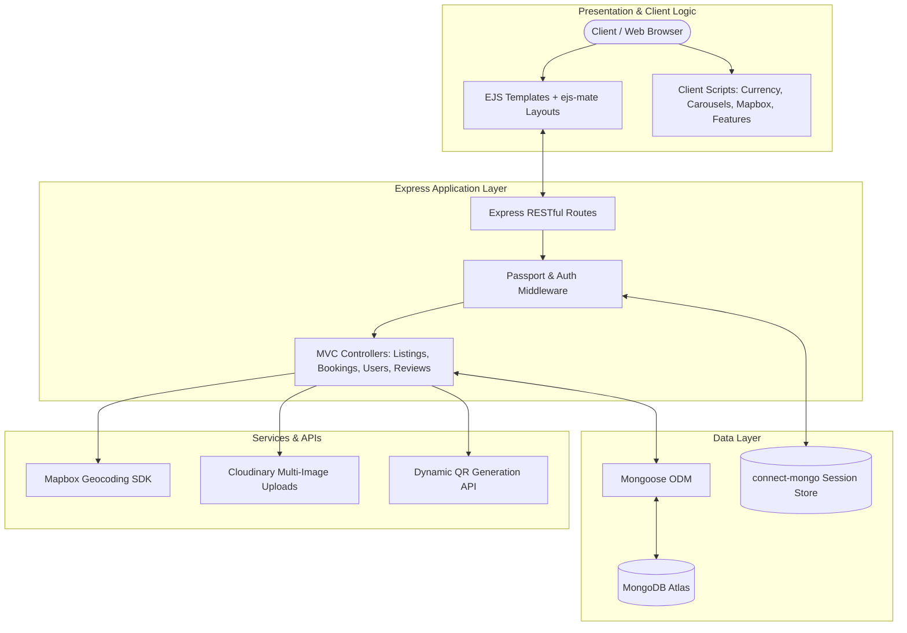

<h1 align="center">Stayria 🏖️</h1>

<p align="center">
  <strong>Next-Generation Full-Stack Vacation Rental & Booking Ecosystem</strong>
</p>

<p align="center">
  
  
  
  
  
  
  
</p>

> **Stayria** is a modern, production-grade vacation rental platform engineered with Node.js, Express, and MongoDB. Inspired by Airbnb's flagship design system, it delivers an immersive booking experience featuring interactive geospatial map exploration, dynamic in-card photo carousels, instant multi-currency switching, an AI-guided travel concierge, and digital boarding passes with dynamic QR codes.

<div align="center">
  <a href="https://stayria.onrender.com"><strong>🌐 View Live Deployment</strong></a> &nbsp;|&nbsp; 
  <a href="#-flagship-features"><strong>✨ Key Features</strong></a> &nbsp;|&nbsp; 
  <a href="#%EF%B8%8F-system-architecture"><strong>🏗️ Architecture</strong></a> &nbsp;|&nbsp; 
  <a href="#-getting-started-local-development"><strong>💻 Local Setup</strong></a>
</div>

---

## ✨ Flagship Features

### 1. 🎟️ Digital Stay Pass & Vector QR Code (`/bookings`)
- **Airline-Style Boarding Pass**: Confirmed bookings generate a digital travel ticket highlighting guest credentials, stay dates, party size, and property details.
- **Dynamic Check-in QR**: Generates dynamic verification QR codes on-the-fly for contactless host check-in.
- **1-Click Print & PDF Export**: Native `@media print` stylesheet optimized for saving clean offline PDF travel documents.

### 2. 🗺️ Interactive Mapbox Explore View (`/listings`)
- **Floating Map/List Switcher**: Smooth 1-tap floating toggle between the curated grid and full-screen geospatial explore mode.
- **Custom Price Markers**: Interactive map pins display live nightly rates with popup property previews.
- **Forward Geocoding**: Automatic coordinate generation `[longitude, latitude]` for addresses on listing creation.

### 3. 🤖 Stayria AI Travel Concierge
- **Floating AI Drawer**: Instant curation assistant recommending top destinations based on travel vibes.
- **1-Tap Themed Discovery**: Filter by *Peaceful Mountain Cabins*, *Luxury Pool Villas*, *Royal Heritage Castles*, *Organic Farm Retreats*, and *Trending This Week*.

### 4. 💱 Real-Time Multi-Currency Engine
- **Instant Global Conversion**: Live client-side conversion across **INR (₹)**, **USD ($)**, **EUR (€)**, and **GBP (£)**.
- **Persistent Preferences**: Saves the user's preferred currency in `localStorage` across page reloads and checkout flows.
- **Complete Parity**: Seamlessly updates all home cards, destination tracks, lightbox tags, and booking breakdowns.

### 5. 📸 Airbnb-Grade Photo Carousels & Fullscreen Lightbox
- **In-Card Touch/Hover Carousels**: Swipe or arrow-click through property photo galleries right from search cards without page navigation.
- **Fullscreen Gallery Modal**: Distraction-free high-resolution lightbox with active thumbnail track, image counters, and keyboard navigation.

### 6. 💳 Itemized Price Breakdown & Date Overlap Protection
- **Transparent Cost Accordion**: Live calculation of base rate, length of stay, cleaning fees, platform fees, and optional 18% GST tax toggle.
- **No Double-Booking**: Query engine actively prevents booking collisions by checking date overlap against existing reservations.

### 7. 💬 Verified Guest "Contact Host" Channel
- **Reservation Gated**: Exclusive messaging channel restricted strictly to guests with confirmed reservations for maximum host privacy.
- **Quick Inquiries & WhatsApp Relay**: 1-tap inquiry chips (*Early check-in?*, *WiFi speed?*, *Parking?*) with instant WhatsApp direct communication.

### 8. 📊 Comprehensive Host Analytics Dashboard
- **Host Metrics**: Real-time aggregation of lifetime earnings, pending payouts, and total guest count.
- **Chronological Sorting**: Automated division of reservations into *Upcoming Stays* and *Past Records*.

---

## 🏗️ System Architecture

Stayria follows a strict **Model-View-Controller (MVC)** architectural pattern:



---

## 📁 Codebase Directory Architecture

```text
stayria/
├── controllers/          # Business logic & request handling
│   ├── booking.js        # Checkout, reservation creation, host analytics
│   ├── listings.js       # Curated sections, search filters, CRUD, geocoding
│   ├── reviews.js        # Review submission & deletion
│   └── users.js          # Authentication (register, login, logout)
├── models/               # Mongoose schemas & data relationships
│   ├── booking.js        # Relational schema (Listing ↔ User ↔ Dates ↔ Status)
│   ├── listing.js        # Properties, GeoJSON coordinates, multi-images
│   ├── review.js         # Ratings & author comments
│   └── user.js           # User credentials & wishlist arrays
├── public/
│   ├── css/              # Modular design systems
│   │   ├── style.css             # Base typography & navigation
│   │   ├── card-enhancements.css # Carousels, badges & destination rows
│   │   ├── show-enhancements.css # Lightbox gallery & price breakdown
│   │   └── features.css          # Boarding Pass, AI concierge & map toggle
│   └── js/               # Modular frontend interactivity
│       ├── card-carousel.js      # Card swipe logic & filter scrolling
│       ├── currency-converter.js # Global multi-currency state manager
│       ├── show-enhancements.js  # Lightbox & share modal controls
│       ├── features.js           # Stay Pass QR, Mapbox pins & AI concierge
│       └── map.js                # Mapbox GL JS single-listing render
├── routes/               # Express REST endpoints
│   ├── booking.js
│   ├── listing.js
│   ├── review.js
│   ├── user.js
│   └── wishlist.js
├── views/                # EJS dynamic UI templates
│   ├── bookings/         # Trips, boarding passes & host analytics
│   ├── includes/         # Navbar, footer, flash alerts
│   ├── layouts/          # Global boilerplate layout
│   └── listings/         # Home, destination rows, show page, CRUD forms
├── schema.js             # Joi validation schemas (data sanitization)
├── middleware.js         # Authentication, authorization & validation guards
└── app.js                # Express application configuration & database bootstrap
```

---

## 🛠️ Tech Stack & Libraries

| Layer | Technologies |
|---|---|
| **Frontend** | HTML5, CSS3, JavaScript (ES6+), EJS, `ejs-mate`, Bootstrap 5, FontAwesome 6 |
| **Backend** | Node.js, Express.js |
| **Authentication** | Passport.js, `passport-local`, `passport-local-mongoose` |
| **Data & Session** | MongoDB Atlas, Mongoose ODM, `connect-mongo`, Express Session |
| **Validation** | Joi Schema Sanitization |
| **Geospatial & Mapping** | Mapbox GL JS v3, `@mapbox/mapbox-sdk` |
| **Media & Storage** | Cloudinary API, Multer, `multer-storage-cloudinary` |
| **Pickers & Utilities** | Flatpickr (range date-picker), Connect Flash, Dotenv |

---

## 💻 Getting Started (Local Development)

### 1. Prerequisites
- **Node.js** (v18.x or v20.x+ recommended)
- **Git**
- A **MongoDB Atlas** database URI or local MongoDB daemon
- A free **Mapbox** token & **Cloudinary** credentials

### 2. Clone the Repository
```bash
git clone https://github.com/sanskritig007/stayria.git
cd stayria
```

### 3. Install Dependencies
```bash
npm install
```

### 4. Configure Environment Variables
Create a `.env` file in the project root:
```env
PORT=3000
ATLASDB_URL=mongodb+srv://<username>:<password>@cluster.mongodb.net/stayria
SECRET=your_super_secret_session_key
MAP_TOKEN=pk.your_mapbox_public_token
CLOUD_NAME=your_cloudinary_cloud_name
CLOUD_API_KEY=your_cloudinary_api_key
CLOUD_API_SECRET=your_cloudinary_api_secret
```

### 5. Launch the Application
```bash
node app.js
```
Open **`http://localhost:3000`** in your browser.

---

## 🔐 Credentials & Demo Testing

For quick manual testing, pre-configured accounts include:
- **Admin/Host Account**: `sanskriti` (Password: `12345`)
- **Demo Guest Account**: `demo12` (Password: `12345`)

---

## 🛤️ Project Milestones & Roadmap

- [x] **Phase 1: Airbnb Flagship Experience**
  - [x] In-card photo carousels on hover/touch
  - [x] Balanced horizontal category filter scroll bar
  - [x] "Guest Favourite" & "Trending" badges
  - [x] Grouped destination rows view with horizontal navigation
- [x] **Phase 2: Booking Flow & Media Overhaul**
  - [x] Fullscreen Lightbox gallery modal with thumbnails
  - [x] Live Multi-Currency engine (INR, USD, EUR, GBP)
  - [x] Interactive itemized price breakdown with GST tax toggle
  - [x] Flatpickr date overlap collision prevention
  - [x] Share Property modal (WhatsApp, Twitter, Copy Link)
- [x] **Phase 3: Standout Innovations**
  - [x] Digital Stay Pass with dynamic QR codes & 1-click print styling
  - [x] Floating Interactive Map Explore view with custom price pins
  - [x] Stayria AI Travel Concierge widget
  - [x] Reservation-gated "Contact Host" verified channel
- [ ] **Phase 4: Future Explorations**
  - [ ] Stripe / Razorpay live payment gateway integration
  - [ ] WebSockets (`Socket.io`) for real-time live host-guest chat
  - [ ] Google & GitHub OAuth sign-in integration

---

## 📄 License
This project is licensed under the [MIT License](LICENSE).
